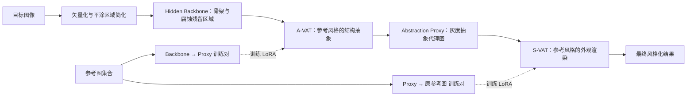

# Abstraction in Style: Beyond Texture and Color — 中文分析

## 1. 论文信息与核心判断

- **作者**：Min Lu、Yuanfeng He、Anthony Chen、Jianhuang He、Pu Wang、Daniel Cohen-Or、Hui Huang。
- **出处**：SIGGRAPH Conference Papers ’26，2026 年 7 月 19–23 日，美国洛杉矶，11 页。以上据所附 PDF 首页。
- **DOI**：[10.1145/3799902.3811082](https://doi.org/10.1145/3799902.3811082)。
- **原文**：[Abstraction in Style2026.pdf](Abstraction%20in%20Style2026.pdf)；[BibTeX](citation.bib)；[来源与校验信息](SOURCE.md)。
- **阅读范围**：用户提供的 11 页 PDF，包括正文、参考文献与结果图；未获取补充材料、作者代码或模型权重，也未运行复现实验。下文页码均指该 PDF。

**一句话概括**：AiS 不只学习“用什么颜色、笔触来画”，还显式学习“这种画风会怎样改变物体形状”，再将改变后的结构渲染成最终图像。

**阅读判断**：论文最有价值的是将风格中的结构变形显式化，并以可观察、可替换的中间表示连接两个生成阶段。它提供了支持这一设计的消融和视觉结果；但小规模评测及复现细节不足，使其更适合作为一个有潜力的方法框架，尚不足以证明对所有风格、复杂场景都稳定有效。

## 2. 研究问题：为什么颜色和纹理还不够？

传统风格迁移常追求保留输入的空间结构，同时迁移笔触、色调和纹理。对几何抽象明显的插画，这一目标可能过于保守：参考风格中的花朵可能只有几个夸张色块，建筑可能被拉长、歪斜，角色比例可能被刻意改变。保持照片中的轮廓，会让结果“表面像参考图，造型仍像照片”。（§1–3，pp. 2–3）

论文据此区分两个任务：

| 任务 | 主要决定什么 | 希望保留什么 |
| --- | --- | --- |
| Structural Abstraction，结构抽象 | 简化、夸张、比例调整、形状重构 | 主体身份、部件关系和基本布局 |
| Visual Stylization，视觉风格化 | 颜色、纹理、线条和渲染方式 | 已得到的抽象结构 |

这里的“抽象”不等于单纯删细节，也不等于通用图像压缩，而是参考风格条件下的结构重新表达。论文对既有方法的概括应理解为其研究动机与所测方法的表现，不宜扩大为“此前所有风格迁移都不能改变几何”。

## 3. 整体方法：先放松几何，再重建造型，最后渲染

图中矢量化、骨架化、腐蚀属于表示构造；A-VAT 与 S-VAT 才是两个学习到的变换。两者使用相同的视觉类比机制，但承担不同任务，并分别适配 LoRA。不能将“共享机制”理解为只有一个共同训练的适配器。（§3–6，pp. 3–5）

### 3.1 Hidden Backbone：为什么不能直接用轮廓或纯骨架？

论文先采用 Wang et al.（2024a）的 *Layered Image Vectorization via Semantic Simplification*，将输入转为具有平涂颜色的简化矢量区域，再将区域栅格化为二值图。（§4.1，p. 4）

随后组合两类信息：

1. **形态学骨架**：通过剥离边界像素得到中心线，原文描述为两像素宽；保留连接关系和主要走向。
2. **区域腐蚀后的残留块**：保留一定的区域体量，弥补纯骨架把厚实部件压成细线的问题。

可将这一设计概括为 `Hidden Backbone = 骨架 ∪ 腐蚀残留区域`。这是对文字描述的表达，不是论文提供的可直接执行算法。

为什么有效：直接给精确轮廓，会限制后续生成对形状的改写；只给细线，又会丢掉胸部、身体、杯身等区域的体量。两者组合试图在“对象仍可识别”和“形状可以重构”之间取得平衡。图 5 展示构造过程，图 10 展示去掉残留区域后的结构退化。

**注意术语**：这里的 Backbone 是一张结构表示图，不是神经网络的特征提取主干；它保留的是结构线索，并不等于具有显式部件语义或受严格约束的拓扑图。

### 3.2 Abstraction Proxy：参考图与目标图的来源不同

参考图已经包含艺术家想要的造型，因此参考代理图 `Proxy_r` 来自对参考图的矢量化，并转为灰度以减弱颜色线索。目标代理图 `Proxy_t` 则需要 A-VAT 生成。（§4.2，p. 4）

这个区别非常关键：**目标的抽象代理图并非简单地把目标图矢量化、去色**；它必须经过学习到的结构转换。图 11 的“仅矢量简化”消融就是在检验这一点。

参考图可构造出两种训练关系：

| 模块 | 参考侧训练关系 | 目标侧推理关系 | 职责 |
| --- | --- | --- | --- |
| A-VAT | `Backbone_r → Proxy_r` | `Backbone_t → Proxy_t` | 学习参考风格中的造型规律 |
| S-VAT | `Proxy_r → 原参考图_r` | `Proxy_t → Output_t` | 学习从抽象形状到最终画面的渲染 |

不需要目标照片与同内容艺术图的人工配对，也不需要显式几何变形标注；但仍需要从参考图构造配对表示，并进行适配训练。因此它不是无需训练的单参考图方法。

### 3.3 VAT：把转换任务放进 2×2 图像类比

两阶段都采用 `A → A′ :: B → B′` 的视觉类比：

| | 左侧：转换前 | 右侧：转换后 |
| --- | --- | --- |
| 上行 | 参考输入 A | 参考输出 A′ |
| 下行 | 新输入 B | 待生成 B′ |

模型看到前三格，补全被遮罩的右下格。训练时用两张参考图构成一个类比样本；推理时下行左格换成目标表示。具体实现基于 **FLUX.1-Fill-dev** 图像修补扩散 Transformer，冻结基础模型，只训练轻量 LoRA。（§5–6，p. 5，图 7）

这借用了 Image Analogies 与视觉上下文学习的思想。新意主要在任务分解、表示选择及其组合，而不是提出全新的扩散骨干、LoRA 算法或几何优化损失。正文没有给出单独的抽象监督损失公式，不应自行补成论文方法。

### 3.4 可控性来自模块组合

图 8 将 3 种 A-VAT 与 4 种 S-VAT 交叉组合：固定渲染模块而改变抽象模块，可以得到外观相近、形状不同的结果；反过来，可以在相近抽象结构上改变外观。（p. 6）

这是“可以分别调换结构风格与外观风格”的定性证据，不等于已证明二者统计独立或完全解耦。灰度代理仍包含分区、明暗与形状信息，生成式 S-VAT 也没有硬性的几何不变保证。

## 4. 实验结果与证据强度

### 4.1 测试设置

§7.2（p. 7）报告：从 Pinterest 选取 10 种设计风格，每种风格使用 2 张由 FLUX.1-dev 随机生成的目标图，共 20 个测试案例，覆盖动物、建筑、食物和物品等主题。这里生成测试输入的 FLUX.1-dev 与承担 VAT 的 FLUX.1-Fill-dev 是不同用途。

比较方法包括 StyleID、Attention Distillation、StyleAlign、B-LoRA、ZipLoRA、K-LoRA 和 Nano Banana。正文称后者为 Nano Banana Pro，表格及用户研究则简写为 Nano Banana；其精确模型版本、调用日期和设置未充分交代。

### 4.2 表 1：完整数值

以下数值逐项核对原文 p. 7 表 1，均为作者报告结果。

| 方法 | CSD ↑ | Style FID ↓ | CLIP-I ↑ |
| --- | ---: | ---: | ---: |
| StyleID | 0.36 | 529.05 | 0.62 |
| Attention Distillation | 0.54 | 431.12 | 0.69 |
| StyleAlign | 0.22 | 511.59 | 0.61 |
| B-LoRA | 0.37 | 495.20 | 0.63 |
| ZipLoRA | 0.34 | 547.73 | 0.66 |
| K-LoRA | 0.25 | 517.42 | 0.60 |
| Nano Banana | 0.56 | 451.17 | 0.68 |
| AiS：无抽象阶段 | 0.46 | 373.03 | 0.64 |
| AiS：仅矢量简化 | 0.66 | 324.84 | 0.71 |
| **AiS：完整方法** | **0.75** | **260.43** | **0.76** |

完整方法在三项指标上均最好。与最有说明力的“仅矢量简化”对照相比，加入学习到的抽象阶段后，CSD 增加 0.09、CLIP-I 增加 0.05，Style FID 降低 64.41（按该对照值计算约降低 19.8%）。这些差值由表中数值计算，不是额外实验。

**指标如何解读**：论文将三项指标用于生成图与参考风格的相似性评估。CLIP-I 在这里不能直接当成“目标内容保持分数”。CSD 与 Style FID 也不能独立证明对象身份、拓扑或局部几何一定正确。测试案例少，正文又未充分说明 Style FID 的特征、采样和聚合细节，因此数值趋势可以参考，但不能过度解读绝对值或泛化稳定性。

### 4.3 消融分别验证了什么？

| 消融 | 原文观察 | 可以支持的结论 | 仍不能证明的事 |
| --- | --- | --- | --- |
| 去掉腐蚀残留区域，只保留骨架 | 狗胸部、企鹅身体等区域退化（图 10，p. 6） | 体量线索对当前表示有帮助 | 已找到最优结构表示；该消融主要是定性证据 |
| 单阶段 AS-VAT：`Backbone → Output` | 出现孔洞、颜色串扰、过度贴合原几何（图 12，p. 7） | 在所测配置下，显式代理和两阶段流程更有效 | 两阶段在任意同算力设置下均优于单阶段 |
| 去掉抽象，以原图输入 S-VAT | 更贴合原输入几何（图 11、表 1） | 外观渲染本身不足以完成所需结构改写 | 所有直接风格化模型都不能抽象 |
| 用矢量简化直接替代 A-VAT | 比无抽象改善，但落后于完整方法 | 学习到的抽象带来超出简化预处理的增益 | 增益对所有类别、风格都成立 |

两阶段与单阶段比较中，作者说明训练图规模相近，但正文未给出足够的参数量、训练算力和推理成本匹配信息。原文称 AS-VAT 为 distilled single-stage variant，却没有展开教师蒸馏目标，不能据此假定有完整的知识蒸馏训练流程。

### 4.4 用户研究

61 名参与者在 20 个案例上盲选“最符合参考风格且保留目标本质”的结果。论文报告选择比例：AiS 50%，Nano Banana 35%，Attention Distillation 15%。另有两位超过 10 年经验的设计师给出定性反馈。（§7.2，pp. 7–8）

AiS 的比例最高，但这不是“50% 准确率”，也不代表在所有基线中做了同一轮盲选。正文未充分说明试次分配、随机化、置信区间或显著性检验，不能把三个比例直接写成具有统计显著性的结论。

## 5. 主要贡献与局限

**值得保留的贡献**有三点。第一，把风格中的几何改写作为显式学习对象；第二，设计“骨架加区域体量 → 灰度代理 → 最终图”的可解释链条，避免一开始用精确轮廓锁死输出；第三，用相同类比机制分别训练结构与外观模块，使它们可以重新组合。

**作者明确承认的局限**：Hidden Backbone 缺少语义感知，可能混淆“腐蚀后变细的区域”与“本来就细的部件”，造成伪影。更强的语义扭曲、夸张和刻意失衡仍需要更丰富的表示与学习机制。（§8，p. 8）

**进一步的阅读判断**：

- **泛化证据有限**：实现以对象为中心，20 个生成目标案例不足以充分说明真实照片、遮挡、多主体或复杂背景上的表现。图 9 展示文字可随主体风格化，但未系统评估文本可读性与准确性。
- **预处理是潜在瓶颈**：矢量化分区、骨架和腐蚀参数若处理不当，结构信息可能在进入模型前已丢失；后续生成只能依赖先验补全。
- **解耦是功能层面的设计**：模块交换有用，但未提供充分定量测量，无法保证结构、颜色、纹理互不影响。
- **少样本不等于低成本**：每种风格需适配 A-VAT、S-VAT，并依赖大型预训练模型。正文没有给出训练时间、显存、吞吐量和推理延迟，不能据此声称轻量或实时。
- **评测可复查性不足**：未获得补充材料；参考图数量口径、基线配置、Style FID 实现和用户研究细节都需进一步核实。

## 6. 复现前必须核实的细节

### 6.1 参考图与训练网格数量存在口径差异

| 位置 | 原文说法 |
| --- | --- |
| §1，p. 2 | 平均每种风格约 10 个 exemplars |
| §4.2、§5，pp. 4–5 | 5–20 个训练 samples；每个类比训练样本由两个参考例子构成 |
| §6，p. 5 | 约 5–20 张 2×2 训练网格，由 10–40 个 exemplars 构成 |
| 图 14 图注，p. 10 | 每种风格完整参考集含 5–10 个 exemplars |

这些说法可能涉及不同实验或对图像复用的不同计数方式，但正文未解释清楚。可以准确概括为“小规模参考集适配”，不能将所有配置统一写成“每种风格固定 10 张图”。

### 6.2 已知信息与缺失信息

| 环节 | 正文明确说明 | 复现需进一步确认 |
| --- | --- | --- |
| 矢量化 | 采用 Wang et al. 2024a 的分层矢量化方法 | 具体实现版本、简化强度、区域组织及失败处理 |
| Backbone | 二值栅格化、形态学骨架、区域腐蚀并合并 | 分辨率、腐蚀核与迭代次数、骨架实现、层间合并 |
| 训练数据 | 参考图派生配对，构成 2×2 网格 | 唯一参考图数量、配对策略、复用方式、增强和数据划分 |
| 模型 | FLUX.1-Fill-dev，冻结基础模型，LoRA 适配 | rank、alpha、注入层、学习率、优化器、步数、batch size |
| 推理 | 前三格作为条件，补全右下格 | 提示词、网格尺寸、遮罩边界、采样步数、guidance、随机种子 |
| 评估 | 10 风格、20 案例、表 1 指标和用户研究 | 指标实现与聚合、基线版本与预算、统计检验、完整输出 |

如果后续复现，建议先在少数形状差异明显的风格上保存完整中间结果：输入、矢量图、Backbone、Proxy、Output。先比较“原图直接渲染 / 仅矢量简化 / 完整方法”，确认收益来自结构抽象，再做模块交叉组合。各方法应固定输入、参考集和随机种子，并记录训练与推理预算。

除了原文指标，还应独立评估目标身份、部件关系、结构变形与文字可读性，并增加真实图像与复杂场景。这些是本笔记的后续实验建议，不是论文已经完成的实验。

## 7. 阅读路线与研究启发

快速理解可按 **图 2–4 → 图 5–7 → 图 8 → 图 10–12 与表 1 → §8** 的顺序阅读：先看问题差异，再看表示与类比实现，最后看可控性、消融和局限。图 13–16（pp. 10–11）用于观察跨风格结果与具体失败差异。

对后续风格迁移研究，最值得借鉴的是：**想让模型主动改变结构，就应在输入表示中保留语义所需的线索，同时有意识地释放精确几何约束，并提供可监督、可观察的结构中间阶段。** 仅加强颜色、纹理的风格约束，未必能得到艺术家式的造型变化。

一个可检验的延伸方向，是给 Backbone 加入部件语义和粗略厚度线索，分别测量它是否减少“细部件与腐蚀残留混淆”的失败，以及是否仍保留足够的造型自由度。该方向由论文局限推导，尚需实验验证。
